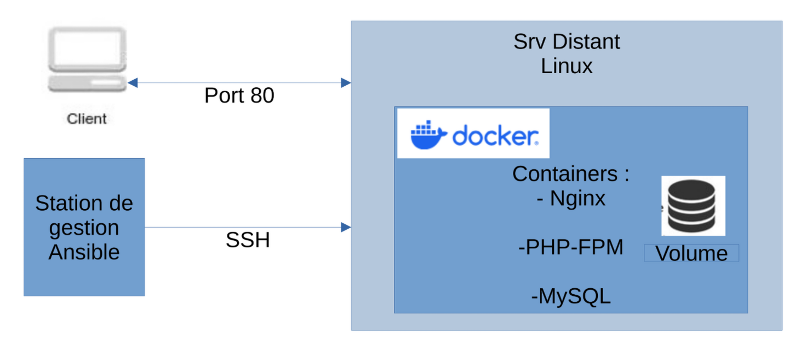
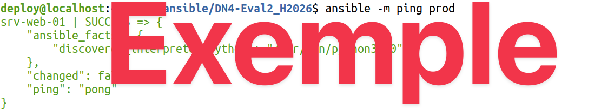
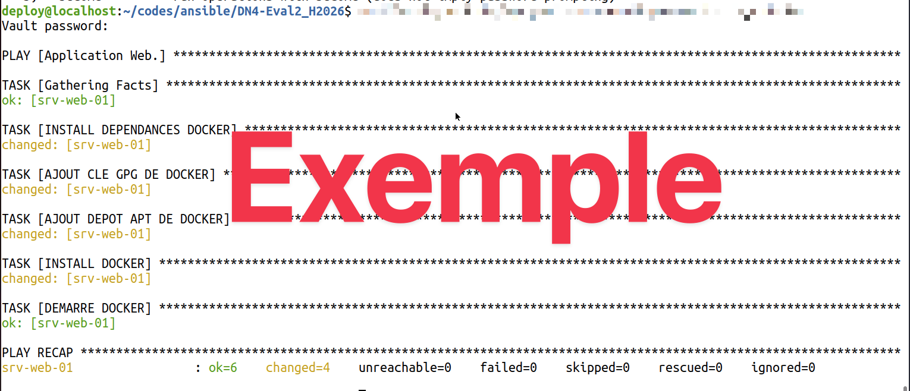
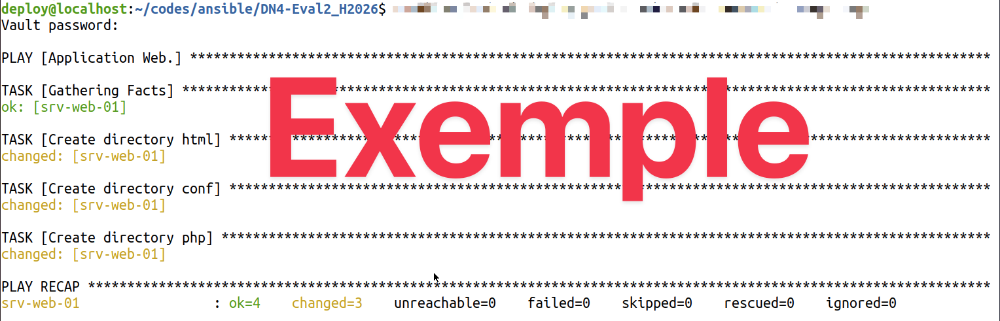
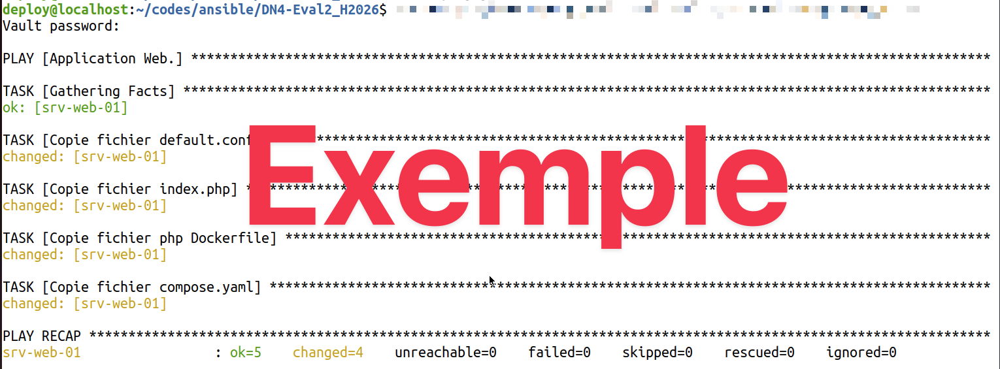
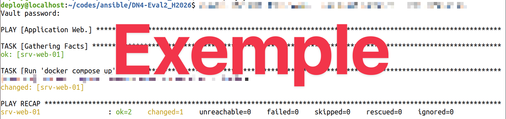
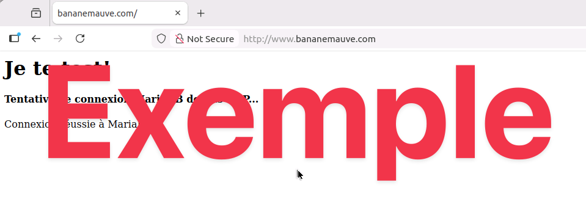
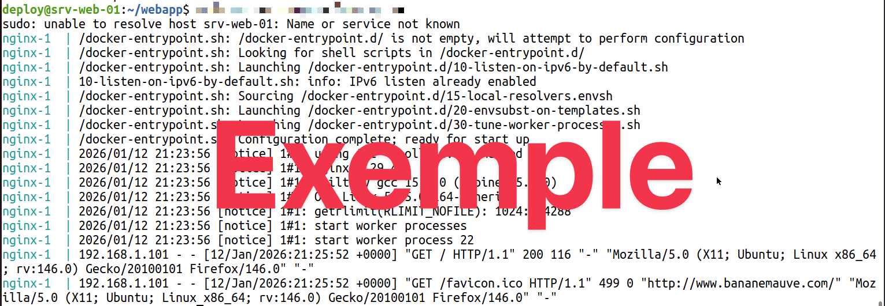

# Évaluation 2

### Informations

- Évaluation : 20 % de la session (15 % pour la partie 1 et 5 % pour la partie 2).
- Type de travail : équipe de 2 pour la partie 1 et individuel pour la partie 2.
- Date de remise : voir sur léa.
- Durée : 6 heures. 
- Système d’exploitation : Linux / Docker
- Environnement : virtuel / Docker.

### Critère d'évaluation

- Applique la politique de vérification de l’authenticité de systèmes.
- Reconnais que le système doit être mis à jour.
- Détermine la pertinence des correctifs proposés.
- Gère les correctifs du système d’exploitation.
- Applique les correctifs.
- Détecter et comprendre des entrées de sécurité dans les journaux.
- Utiliser un logiciel pour lire les journaux.
- Suivre en temps réel les journaux
- Applique la politique d’installation et de vérification d’installation du logiciel de sauvegarde.
- Applique la politique de sauvegarde des données.
- Applique la politique de sauvegarde des appareils réseau.
- Configure les droits d’accès aux journaux et aux serveurs de journaux, selon la politique de sécurité.
- Installe et configure le service de journalisation des sauvegardes.
- Effectue la lecture des journaux du serveur de sauvegarde pour comprendre les entrées.
- Localise les journaux d’un système d’exploitation.
- Lis les journaux.
- Détermine un évènement de sécurité à l’intérieur d’un journal.


### Description

Cette évaluation à deux parties.  

La première partie touchera l'intégrité du système où vous aurez plusieurs tâches à accomplir pour vérifier les compétences ci-dessus.    

La deuxième partie sera un questionnaire sur les sujets des cours précédents.  

## Prérequis  
- Une machine de gestion avec Ansible installé.  
- Une VM distante.  
  - Vous pouvez utiliser un de vos deux serveurs srv-web-01 ou srv-mysql-01. Si vous utilisez srv-web-01, n'oubliez pas d'arrêter le conteneur ```webapp```.
- Accès SSH sans mot de passe à la VM distante depuis la machine de gestion.  

**Notes :** Vous pouvez réaliser ce travail sur votre infrastructure local ou sur CyberQuebec.

## Partie 1 : Déploiement d'un environnement avec Ansible

### Description du projet  

Vous allez déployer une application Web simple comprenant les composants suivants :  

   - Nginx : Serveur web pour gérer les requêtes HTTP.  
   - PHP (FPM) : Interprète PHP pour exécuter le code de l'application.  
   - MySQL : Serveur de base de données pour stocker les données de l'application.  

L'ensemble de ces composants sera déployé en tant que conteneurs Docker sur votre VM distante, orchestrés par **Docker Compose**. Ansible sera utilisé pour automatiser l'installation de Docker, Docker Compose (inclus dans l'installation de Docker), les dépendances nécessaires sur la VM et le système complet pour l'application.  

### Étapes détaillées

 1- Configuration de l'environnement Ansible :  
  - Créer un inventaire Ansible pour définir votre VM distante.  
  - Vérifier la connectivité SSH sans mot de passe.  
 
 2- Création du playbook Ansible :  
   - Installer les dépendances nécessaires pour le module Docker d'Ansible.  
   - Installer Docker (qui doit inclure Docker Compose) sur la VM distante.  
   - Démarrer et activer le service Docker.  
 
 3- Déploiement de l'application avec Docker Compose :  
   -  Créer un fichier ```compose.yaml``` définissant les services Nginx, PHP-FPM et MySQL (je vous recommande de consulter les exercices de votre cours 420-DN2-SF).    
   -  Utiliser des volumes Docker pour la persistance des données de la base de données et des volumes pour les fichiers nécessaires au système et à l'application.  
   -  Le site Web doit répondre à votre nom de domaine de l'exercice 4. Par exemple, pour moi j'aurais <http://www.bananemauve.com> et <http://bananemauve.com>. Configurer votre machine de gestion pour associer l'adresse IP de la VM distante à ces noms.  
     
 4-  Configuration des services web :   
   -  Créer un fichier de configuration Nginx pour diriger les requêtes vers le conteneur PHP-FPM.  
   -  Utiliser une page ```index.php``` pour tester la connexion à la base de données.  
   -  Placer le fichier ```index.php``` dans le dossier html qui sera monté en volume dans les conteneurs de nginx et php.  

 5- Compléter le playbook Ansible :  
   - Vous devez créer la structure de répertoire sur le serveur.  
   - Vous devez copier les fichiers sur le serveur pour les services Docker Compose.  
   - Vous devez configurer le lancement du système avec docker compose **v2**.  

 6- Exécution du playbook Ansible :  
   - Exécuter le playbook Ansible pour déployer l'application sur la VM distante.  
   - Vérifier que les conteneurs sont en cours d'exécution et que l'application est accessible via un navigateur web.  
   - Dans votre playbook, vous devez prévoir de relancer les services (si vous avez fait un changement à un fichier) et arrêter les services (l'utilisation de *tags*).  
     
 7- Tests et validation :  
  - Vérifier que la page ```index.php``` affiche les informations de connexion à la base de données.  
  - Vérifier les journaux des conteneurs pour identifier les éventuelles erreurs.  

## Description de l'infrastructure  

Vous allez utiliser une structure comme celle-ci :  

  
**Figure 1 : schéma de l'évaluation.**  

## Points importants

 - Utiliser des variables et *tags* Ansible pour rendre votre code plus modulaire et réutilisable.  
 - Utiliser ansible-vault, avec le mot de passe **secret**, pour le chiffrement des informations sensibles.  
 - Documenter votre code avec des commentaires clairs et concis.  
 - Débuter par faire fonctionner votre application avec Docker Compose localement avant de le faire fonctionner sur la VM distante.  
 - Monter votre fichier de déploiement graduellement :  
   1- Test l'installation de Docker.  
   2- Test la création de dossiers.  
   3- Test la copie des fichiers des services et de l'application.  
   4- ...
 - Tester votre code régulièrement pour identifier et corriger les erreurs.  
 - Utiliser le système de contrôle de version (Git) pour gérer votre code.  

**Notes :** Un rappel de l'installation de Docker pour votre station de contrôle.  
```bash  
curl -fsSL https://get.docker.com -o get-docker.sh
sh get-docker.sh
sudo usermod -aG docker VotreNomUtilisateur
sudo docker version 
```  

## Partie 2 : Questionnaire  

Vous devez répondre aux questions sur le lien donné sur léa.  

## Remise pour la partie 1  

Vous devez fournir (déposé sur LÉA) :

- L'adresse de votre dépôt GitHub dans un fichier texte.

Vous devez fournir (déposé sur GitHub) :

  - Le dépôt GitHub privé 
      - Un fichier README.md qui résume les informations sur le dépôt.  
      	- Nom du projet  
        - Date 
        - Description du projet  
        - Noms des membres  
      - Le dépôt doit inclure tous vos fichiers de code source de l'évaluation  (playbook Ansible, fichier compose.yaml, .traces\_d\_ansible, fichiers de configuration Nginx et PHP...). Je dois pouvoir reproduire votre installation.  
      - Naturellement, je dois être collaborateur du dépôt github (claude-roy).  
      - Vous devez utiliser le format Markdown (md).  
      - Vous devez donner vos sites de références.  
    - Un document Markdown nommé `Section1_Validation.md` contenant les informations suivantes :  
  	  - Une capture d'écran d'un ping (avec ansible) aux appareils de `prod`.  
  	  - Une capture d'écran de l'installation de Docker.  
  	  - Une capture d'écran de la création de répertoires/dossiers.  
  	  - Une capture d'écran de la copie de vos fichiers vers la machine distante.  
  	  - Une capture d'écran du lancement des conteneurs.  
  	  - Une capture d'écran de votre navigateur affichant le site Web avec la connexion à la BD. Je dois voir votre FQDN dans l'URL.  
      - Une capture d'écran des journaux (logs) de votre serveur Web.

### Exemple d'images  

Voici des exemples d'images à inclure dans votre dépôt github. Les informations dans les images peuvent varier selon la manière que vous avez créé votre projet. Mais, l'information principale doit être la même.  

  
**Figure 2 : exemple de vérification de connexion ssh.**  

  
**Figure 3 : exemple de l'installation de Docker.**  

  
**Figure 4 : exemple de création de répertoires/dossiers.**  

  
**Figure 5 : exemple de copie de fichiers.**  

  
**Figure 6 : exemple du lancement des conteneurs.**  

  
**Figure 7 : exemple de page Web avec connexion à la BD.**  

  
**Figure 8 : exemple de journaux du serveur Web.**  

## Évaluation :

### Partie 1 (15 %)  


| Item                  | Points | Résultat | Commentaires|  
| --------------------- | -----: | :-------: | :----|  
| Configuration, installation de Docker sur la VM distante |    10 |           | |  
| Utilisation appropriée des variables, *tags* Ansible et Docker compose|    15 |  |  |  
| Page Web d'identification fonctionnelle | 15 |   |  |  
| Fichiers de configurations clairs et **bien documentés** |    30 |   |  |  
| Fonctionnement : Fichier `.traces_d_ansible` d'ansible.           |           15          |       |     |
|Fichier Section1_Validation.md.                           |  15   |   |     |
| **Total**             | **100** |   |  |  

### Partie 2 : (5 %)  

Le résultat vous sera donné à la fin du questionnaire.


## Informations supplémentaires :

Pour créer un playbook qui regroupe tous les playbook, vous utilisez le module <code>import_playbook</code>.

```yaml
---
- name: Configure Docker
  ansible.builtin.import_playbook: docker.yaml
- name: Configure le serveur Web
  ansible.builtin.import_playbook: webapp.yaml

```

Vous pouvez utiliser le module <code>copy</code> dans un playbook :

```yaml
  tasks:
    - name: Telecharger Application
      copy:
        src: ./html/index.php
        dest: /home/admin/html/index.php
        mode: 0755

```

Pour organiser vos fichiers, vous pouvez créer des répertoires avec le module <code>file</code> :

```yaml
  tasks:
    - name: Creates directory
      ansible.builtin.file:
        path: /home/admin/html
        state: directory
        owner: admin
        group: admin
        mode: 0775
```

## Références :

[A system administrator's guide to getting started with Ansible - FAST!](https://www.redhat.com/en/blog/system-administrators-guide-getting-started-ansible-fast)  
[Documentation officielle d'Ansible](https://docs.ansible.com)  
[Documentation ansible pour fichier inventaire avec des relations parent/enfant](https://docs.ansible.com/ansible/latest/inventory_guide/intro_inventory.html#grouping-groups-parent-child-group-relationships)  
[Documentation ansible pour group_vars](https://docs.ansible.com/ansible/latest/inventory_guide/intro_inventory.html#organizing-host-and-group-variables)  
[Documentation ansible pour import_playbook](https://docs.ansible.com/ansible/latest/collections/ansible/builtin/import_playbook_module.html)  
[Documentation ansible pour copy](https://docs.ansible.com/ansible/latest/collections/ansible/builtin/copy_module.html)  
[Documentation ansible pour file](https://docs.ansible.com/ansible/latest/collections/ansible/builtin/file_module.html#file-module)  
[Documentation officielle de Docker](https://docs.docker.com)  
[Documentation de Community.Docker](https://docs.ansible.com/ansible/latest/collections/community/docker/index.html#description)  
[How to run docker-compose commands with ansible?](https://stackoverflow.com/questions/62452039/how-to-run-docker-compose-commands-with-ansible#62452959)  
[Ansible mange Docker containers](https://docs.ansible.com/ansible/latest/collections/community/docker/docker_container_module.html#ansible-collections-community-docker-docker-container-module)  
[Documentation pour une adresse statique sur un serveur Ubuntu 22.04](https://www.linuxtechi.com/static-ip-address-on-ubuntu-server/)  
[Documentation pour l'utilisation de la fonction php_uname](https://www.php.net/manual/en/function.php-uname.php)
